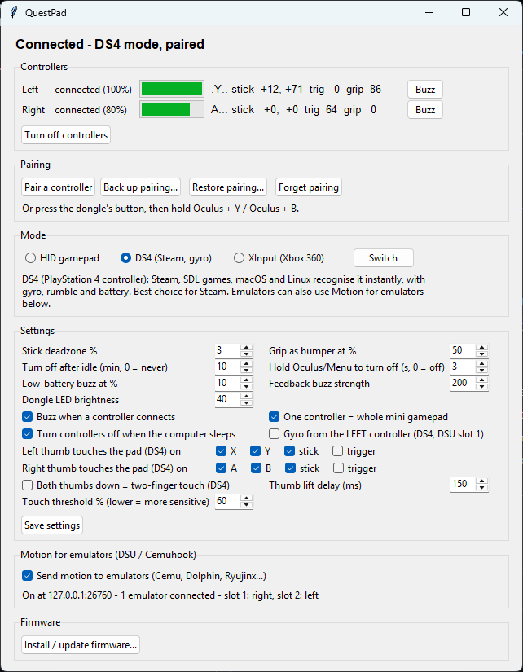

<div align="center">

# QuestPad

**Use Meta Quest Touch controllers as a regular controller.**

[](https://github.com/Jakey-Jakey/questpad/actions/workflows/build.yml)
[](#license)



</div>

Quest controllers work with headsets over a private 2.4 GHz radio link. QuestPad is firmware that allows a **Nordic nRF52840 Dongle** (about $11 USD) to speak that protocol, so the controllers connect to it as if it were a headset. Your computer then sees one combined controller: sticks, triggers, buttons, rumble, and gyro in DS4 mode. (I think) This is the first way to connect Meta Quest controllers directly to a PC.

## Features
- **Both controllers as one gamepad**, laid out like an Xbox pad, and one controller alone works as a mini gamepad.
- **Three USB modes**: generic gamepad, PlayStation 4 controller, or Xbox 360 controller (XInput games on Windows).
- **Gyro with touch-to-aim** (DS4 mode): rest your thumb on the controller to aim, lift it to re-centre.
- **Rumble**, plus small buzzes when a controller connects and when its battery runs low.
- **Pair with one button press** on the dongle; no computer needed. 
- **An off switch the controllers never had**: hold Oculus or Menu for 3 s, put them down, and they switch off after about a second.
  They also switch off when idle or when the computer sleeps, and wake when you pick them up.
- **Standalone**: once set up, plug the dongle in anywhere. The control panel is only for setup and settings.

## Supported controllers
| controller | status | notes |
|---|---|---|
| **Quest 1** Touch | ✅ working | Tested with controller firmware 1.17.2 (bootloader 1.13.0). |
| **Quest 2** Touch | ❔ untested | Probably a close relative of the same protocol, but newer controllers appear to use a key-exchange based pairing that Quest 1 controllers don't, so pairing would need that added. |
| **Quest 3 / 3S** Touch Plus | ❔ untested | Nothing known yet. |

Contributions that make QuestPad work with more controllers are very welcome. See
[Supporting a new controller](#supporting-a-new-controller).

| computer | status |
|---|---|
| macOS | ✅ all modes tested |
| Windows | ✅ all modes should work, generic gamepad mode tested |
| Linux | ❔ untested (DS4 mode uses the kernel's `hid-playstation` driver, XInput mode `xpad`) |

## What you need
- A **Nordic nRF52840 Dongle** (PCA10059)
- Your Touch controllers
- **Python 3** for the control panel

## Quick start
1. **Download** the latest `questpad-<version>.zip` from [Releases](https://github.com/Jakey-Jakey/questpad/releases)
   and unzip it.
2. **Open the control panel**: double-click **`QuestPad.pyw`** (Windows) or **`QuestPad.command`** (macOS), or run
   `python3 host/gui.py`.
3. **Install the firmware**: click **Install / update firmware…**, choose `questpad.bin`, then press the dongle's
   small **sideways RESET button** (the red LED pulses) and click OK. You only need the button this first time.
4. **Pair each controller**: tap the dongle's button (or click **Pair a controller**), then hold
   **Oculus + Y** (left) or **Oculus + B** (right) until the controller's light blinks. The dongle flashes green and
   the controller buzzes.
5. **Pick a mode** in the panel (**DS4** is best for Steam) and play. From now on the dongle works on its own.

Click **Back up pairing…** once and keep the file somewhere safe (and private: it's your controllers' key).
Reinstalling the firmware through the RESET button can erase the pairing, and the backup saves re-pairing.

## Using QuestPad
**Button layout.** Left: stick, X / Y, trigger → LT, grip → LB, Menu → Start, stick click → LS. Right: stick, A / B,
trigger → RT, grip → RB, Oculus → Guide, stick click → RS.

**Gyro and touch.** In DS4 mode the dongle sends the gyro of one controller (right by default) and turns each
thumb into a touch on its half of the DS4 touchpad. Games with built-in gyro use it directly. Anything that can
switch gyro on with a touchpad touch, like Steam Input, can turn it into touch-to-aim.

In the control panel you choose which buttons sense your thumb (face buttons and / or stick), how long a lift takes
to count (150 ms by default, to ride out sensor dropouts), and whether both thumbs at once is a two-finger touch.
By default only the gyro controller's thumb counts, so the other thumb never interrupts aiming.

**Modes.**
| mode | LED | use it for |
|---|---|---|
| Generic gamepad | green | anything that takes a USB gamepad; Steam asks you to map the buttons once |
| DS4 (PlayStation 4) | blue | **Steam**, SDL games, emulators, macOS, Linux: no setup, gyro, rumble, battery |
| XInput (Xbox 360) | purple | If you don't need gyro this is recommended |

Switch in the panel or by holding the dongle's button for 3 s (it steps through the modes in the above order).

**The dongle's light.**
| light | meaning |
|---|---|
| mode colour, solid | a controller is connected |
| mode colour, slow blink | waiting for controllers |
| fast blue blink | pairing |
| red | not paired yet |
| three green / red flashes | pairing worked / failed |

**The dongle's big button.** Tap = pair a controller (tap again to cancel) · hold 3 s = next mode · hold 10 s = forget the
pairing.

**Turning controllers off.** Hold **Oculus** or **Menu** for 3 s until they buzz, then put them down; each switches
off once it's still. They also switch off after 10 minutes untouched and when the computer goes to sleep.
Pick one up (or press a button) to wake it.

**Settings** (control panel): stick deadzone, grip strength that counts as LB / RB, idle time before switching off,
the hold time for the off gesture, low-battery warning level, buzz strength, dongle LED brightness, connect buzz,
one-controller mini pad, switch-off on computer sleep, which controller's gyro DS4 mode uses, and the DS4 touchpad
thumb sensors and lift delay.

## Troubleshooting
**Steam asks me to set up the controller.** That's the generic gamepad mode. Switch to DS4 mode and Steam
recognises it as a PlayStation 4 controller with everything already mapped.

**The control panel says "Dongle not found".** Check it's plugged in. In **XInput** mode the panel can't reach the
dongle (Windows' Xbox driver owns it): hold the dongle's button 3 s to switch to the generic mode first. On Linux,
add yourself to the `dialout` group (or equivalent) so the panel can open the dongle's serial port.

**A controller won't connect.** Press a button to wake it. If it still doesn't appear (dongle light blinking),
pair it again. After a firmware reinstall, use **Restore pairing…** or re-pair both controllers.

**The panel doesn't open on macOS.** Don't use Apple's built-in Python. Install Python from
[python.org](https://www.python.org/downloads/) and open `QuestPad.command` again.

**Firmware install says no bootloader was found.** Press the small sideways RESET button on the dongle (the red light
starts pulsing), then try again.

## For developers
You need Rust (stable) with the `thumbv7em-none-eabihf` target, and Python 3.
```sh
rustup target add thumbv7em-none-eabihf
firmware/flash.sh            # build and flash in place (add --dfu for the RESET-button bootloader)
tools/package.sh             # build the release zip into dist/
```

| path | what |
|---|---|
| `firmware/` | dongle firmware (Rust, [embassy](https://embassy.dev)) |
| `host/gui.py` | control panel (Tkinter; pySerial bundled in `host/vendor`; `--demo` shows sample data) |
| `host/link.py` | `--watch` live inputs / IMU / battery / link stats, `--log` the controllers' own debug log |
| `host/regs.py` | read and write controller registers |
| `host/dm.py`, `host/sniff_adv.py` | pairing-mode tools |
| `research/` | the analysis scripts used to work out the protocol |

**How it works:** the radio protocol, pairing, encryption, controller data and the dongle internals are written up
in **[PROTOCOL.md](PROTOCOL.md)**. Ideas for the future are in [IDEAS.md](IDEAS.md). No idea if I'll get to 'em.

## Supporting a new controller
If you have Quest 2 or Quest 3 controllers, you can help: the steps for capturing what a controller sends, and what
to look for, are in [PROTOCOL.md → Adding another controller](PROTOCOL.md#adding-another-controller). A pull request
with partial findings is useful too.

## Acknowledgements
- [GP2040-CE](https://github.com/OpenStickCommunity/GP2040-CE): the DS4 report descriptor and Xbox 360 USB layout
  used by the DS4 and XInput modes.
- [embassy](https://embassy.dev): the async Rust framework the firmware runs on.
- [pySerial](https://github.com/pyserial/pyserial): bundled so the control panel needs only Python.

## License
Licensed under either of [Apache License 2.0](LICENSE-APACHE) or [MIT license](LICENSE-MIT), at your option.
Bundled pySerial is BSD-3-Clause (`host/vendor/serial/LICENSE.txt`); the GP2040-CE parts are MIT (noted in
`firmware/src/ds4.rs` and `firmware/src/xinput.rs`).

QuestPad is not affiliated with, endorsed by, or supported by Meta, Sony or Microsoft. "Meta", "Oculus", "Quest" and
"Touch" are trademarks of Meta, used here only to describe which hardware this works with.
