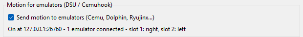

# Motion in emulators

QuestPad's control panel can share each Touch controller's gyro and accelerometer with emulators, the same way
DS4Windows or BetterJoy do: as a **DSU (Cemuhook) server**. Cemu, Dolphin, Ryujinx and other emulators with a
"DSU" or "Cemuhook" input option can then use the controllers for motion controls, like aiming a bow by tilting.



## Turn it on
1. Put the dongle in **DS4** mode (or HID). XInput mode has no connection to the control panel, so no motion.
2. In the control panel, tick **Send motion to emulators**. The panel remembers this, so next time it starts on its
   own. Keep the panel open while you play: it is the motion server.
3. Set the controllers down on a desk for a second now and then (before you start is enough). QuestPad uses that
   moment to measure each gyro's small drift and remove it, so your aim doesn't slowly wander.

The panel shows what's connected, for example `On at 127.0.0.1:26760 - 1 emulator connected - slot 1: right,
slot 2: left`.

**Which controller is which.** Emulators see up to two DSU controllers. **Controller 1** is the controller DS4 mode
takes its gyro from: the right one, or the left if you tick *Gyro from the LEFT controller* in Settings (or if
it's the only one on). **Controller 2** is the other one. Both also carry all the buttons and sticks.

## Cemu
Cemu gets the buttons from the controller itself and the motion from QuestPad, both on the same Wii U GamePad.

1. **Options → Input settings**, tab **Controller 1**. Set **Emulated controller** to **Wii U GamePad**.
2. Buttons: click **+** next to *Controller*, choose API **SDLController**, pick the **PS4 Controller**, click **Add**.
   Cemu maps its buttons by itself.
3. Motion: click **+** again, choose API **DSUController**. Leave IP `127.0.0.1` and port `26760`, pick
   **Controller 1**, click **Add**.
4. With the DSUController entry selected in the *Controller* list, click **Settings**, tick **Use motion**, click
   **OK**. Leave *Use motion* off for the SDL entry, so only one source moves the GamePad.
5. Save it as a profile so you only do this once.

Try it in a game with gyro aiming: tilt the right controller and the view should follow.

In HID mode, step 2 needs the buttons mapped by hand instead (SDL doesn't know the generic gamepad); DS4 mode is the
easy way.

## Other emulators
Any emulator with a DSU or Cemuhook option works the same way: server `127.0.0.1`, port `26760`, then choose
controller (or "pad" / "slot") 1 for the gyro controller, 2 for the other. This hasn't been tried with Dolphin or
Ryujinx yet; reports welcome. Two controllers give two separate motion sources, for example a Wii Remote and a
Nunchuk, or a pair of Joy-Cons.

## Troubleshooting
**"Couldn't start: port 26760 is in use".** Another DSU server is running: DS4Windows, BetterJoy, or a second
QuestPad panel. Close it, then tick the box again.

**The emulator finds no DSU controller.** Check the panel says *On* and lists a slot, and that the controllers are
awake (press a button). The emulator must use `127.0.0.1` and port `26760`.

**The aim drifts slowly.** Put both controllers down on a desk for a second so QuestPad can measure their drift.

**Motion goes the wrong way.** Run the direction check below and open an issue with what it prints.

## Checking it without an emulator
`host/dsu_client.py` connects the way an emulator does:

```sh
python3 host/dsu_client.py            # live numbers for each slot
python3 host/dsu_client.py --guided   # a few poses and turns, checking every direction
```

Without the panel, `python3 host/dsu.py` runs the same server from the command line (on Windows, close the panel
first: only one program at a time can open the dongle). Directions follow DS4Windows with a DualShock 4, which DSU
emulators are tuned for; [PROTOCOL.md](../PROTOCOL.md#controller-data) has how they were checked.
